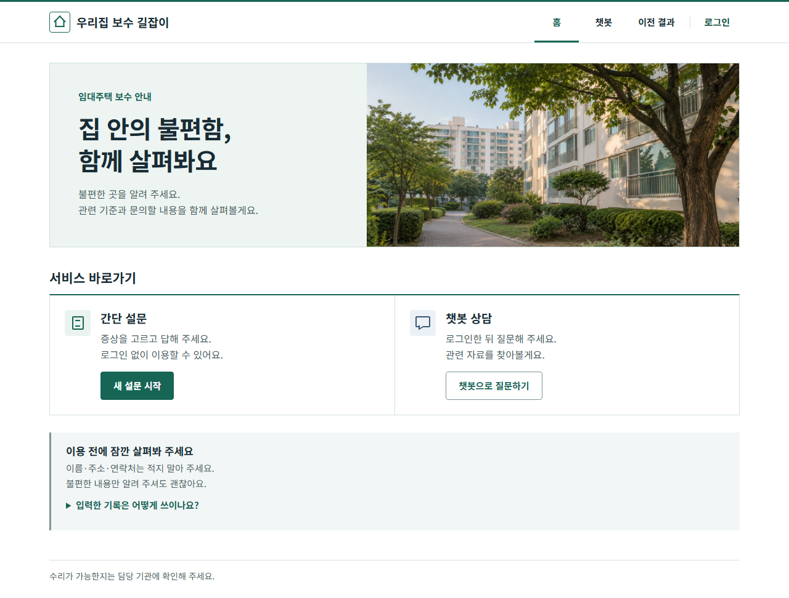
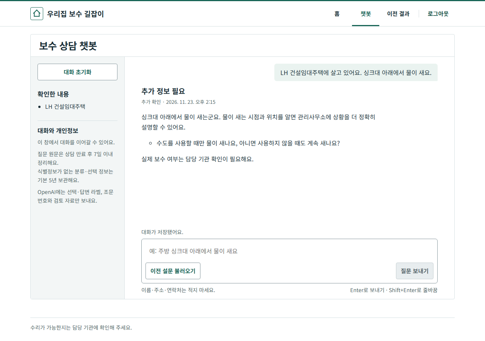

# 우리집 보수 길잡이

집 안에 문제가 생겼을 때 무엇을 먼저 살펴보고 관리사무소에 어떤 내용을 전하면 좋을지 안내합니다.\
**LH 건설임대주택과 분양전환형 주택에 임대로 거주하는 분을 위한 서비스입니다.**\
시설 이름을 몰라도 겪고 있는 증상으로 시작할 수 있습니다.

## 이용 방법

- **간단 설문**은 로그인 없이 이용할 수 있습니다. 문제가 생긴 곳과 증상을 고르고 짧은 질문에 답하면, 확인할 사항과 관리사무소에 문의할 내용을 볼 수 있습니다. 답이 확실하지 않다면 ‘모르겠어요’를 선택할 수 있습니다.
- **챗봇 상담**에서는 로그인한 뒤 “싱크대 아래에서 물이 새요”처럼 일상적인 말로 질문할 수 있습니다. 관련 기준이 있으면 쉬운 설명과 출처를 함께 안내합니다. 필요할 때는 채팅창에서 이전 설문을 불러올 수 있습니다.
- **이전 결과**에서는 로그인한 상태에서 작성한 설문 결과를 다시 볼 수 있습니다.

실제 보수 가능 여부와 비용은 관리사무소나 담당 기관에서 확인할 수 있습니다. 안내 결과에서 문의 내용을 복사해 직접 전달할 수 있습니다.

## 예시 화면

### 메인 화면

### 챗봇 상담 화면

싱크대 아래 누수에 관한 예시 대화입니다.

## Windows에서 실행하기

1. Docker Desktop을 켜고 Linux 컨테이너 모드인지 확인합니다.
2. 저장소 폴더에서 `test-deploy.bat`를 실행합니다.
3. 실행이 끝나면 브라우저에서 [localhost:8080](http://localhost:8080)에 접속합니다.
4. 사용을 마치면 `stop-test-deploy.bat`를 실행합니다.

`.env`가 있으면 해당 설정을 우선 적용합니다. 설정 파일이 없어도 예제 환경에서 설문을 체험할 수 있습니다. 챗봇의 AI 답변 설정은 로컬 실행 안내에서 확인할 수 있습니다. [로컬 실행과 개발 검증](docs/development/local.md)

## 관련 문서

- 테스트 주소를 공유하려면 `test-deploy.bat -OpenTunnel`을 실행합니다. [터널 테스트](docs/operations/deployment.md#windows-cloudflare-quick-tunnel-테스트)
- Prometheus와 Grafana를 함께 실행하려면 `test-deploy.bat -Monitoring`을 사용합니다. [Windows 테스트 모니터링](docs/operations/monitoring.md#windows-테스트-실행)
- 자동 테스트는 저장소의 `Jenkinsfile`로 실행합니다. [Jenkins 설정](docs/development/local.md#6-jenkins-자동-테스트)
- 서비스 범위와 화면, 기준 자료, 시스템 구성은 설계 문서에서 확인할 수 있습니다. [설계 문서 모음](docs/README.md)
