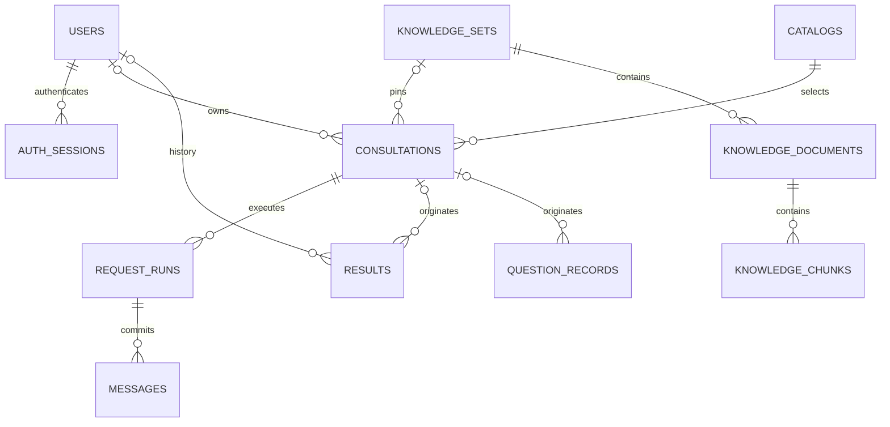

# DB·데이터 역할 설계 — 단일 PostgreSQL + pgvector

상위 문서: [전체 안내](README.md) · 계약: [API](03-backend.md) · 검토: [RAG](05-ai-rag.md)

## 1. 선택과 단순화

업무 데이터·정제 질문·카탈로그·원문·임베딩을 **PostgreSQL 한 데이터베이스**에 저장한다. 이전 MySQL + PostgreSQL은 초기 기본안에서 제외한다. pgvector로 일반 관계 데이터와 벡터를 같은 DB에서 관리할 수 있다. [공식 문서](https://github.com/pgvector/pgvector)

연결 풀·Alembic 이력·백업·복구를 하나로 운영한다. 계정과 지식은 테이블 이름과 서비스 코드로 구분한다. DB 간 ID 교차 검사·복제·동기화·분산 잠금은 없다. 나중에 MySQL 필수 제약이나 독립 확장 요구가 생기면 분리를 다시 설계한다.

UUID·TIMESTAMPTZ·JSONB를 사용하고 시행일은 DATE, 불명확하면 null이다. 내용 해시는 SHA-256이다. 실제 주택 주소·연락처·토큰 원본을 질문·임베딩에 저장하지 않는다.

## 2. 초기 테이블 12개

요구를 구현하는 테이블만 둔다. staging 배치·동의어·통계 집계·임베딩 프로필·청크 관계·게시 이벤트를 각각 별도 시스템으로 일반화하지 않는다.

| 테이블 | 주요 열·제약 | 책임 |
| --- | --- | --- |
| users | id, normalized_email UNIQUE, password_hash, status, created_at | 최소 계정 |
| auth_sessions | id, user_id FK, token_hash UNIQUE, csrf_hash, expires_at | 쿠키 인증; 해시만 저장 |
| catalogs | version PK, status, payload_json, published_at | 완성된 목록·질문·조건; 게시본 불변 |
| consultations | id, owner_user_id nullable FK, guest_token_hash nullable, catalog_version FK, knowledge_set_id nullable FK, revision, context_json, created_at, expires_at | 24시간 회원·비회원 상담 |
| request_runs | id, consultation_id FK, request_id, kind, request_hash, state, created_at, finished_at, response_json | UNIQUE(consultation_id, request_id); 실행·완료·실패와 중복 응답 |
| results | id, consultation_id nullable FK, owner_user_id nullable FK, request_run_id nullable FK, question_record_id nullable FK, input_snapshot_json, payload_json, created_at, retained_until | 양쪽 결과 저장, 회원 이력 |
| messages | id, consultation_id FK, request_run_id FK, role, content, citations_json, created_at | UNIQUE(request_run_id, role); 단기 대화 |
| question_records | id, consultation_id nullable FK, owner_user_id nullable FK, origin_key UNIQUE, kind, catalog_version, answers_json, masked_question, retrieval_meta_json, created_at, retained_until | 3~5년 정제 질문·통계 원본 |
| knowledge_sets | id, catalog_version FK, status, embedding_model, embedding_dimensions, manifest_json, published_at | BUILDING/PUBLISHED/WITHDRAWN, 지식 묶음 |
| knowledge_documents | id, knowledge_set_id FK, source_key, version_label, kind, title, url, normalized_text, content_hash, scope_json, effective_date, reviewed_at, review_until, reviewer_key, status, withdrawn_at, withdrawal_reason | 원문 버전·승인·적용 조건 |
| knowledge_chunks | id, document_id FK, ordinal, locator, body, content_hash, embedded_content_hash, embedding, metadata_json | 조·별표 청크와 벡터를 한 행에 저장 |
| deletion_log | id, entity_type, entity_id, deleted_at, expires_at | 백업 복원 뒤 삭제 재적용; 본문 없음 |

consultations는 회원 소유 ID와 익명 토큰 해시 중 정확히 하나만 존재하도록 CHECK한다. auth_sessions는 계정 삭제 시 CASCADE한다. 장기 기록·회원 결과 삭제는 보존·명시적 삭제 정책대로 처리한다.

request_runs는 영속 작업 큐가 아니다. lease·attempt·자동 재처리 없이 같은 요청의 완료 응답만 재생한다. PROCESSING/COMPLETED/FAILED는 단순 상태이며 실패한 요청은 자동으로 재실행하지 않는다. 세부 정책은 03을 따른다.

검토 전 원문과 전체 문장 정리는 접근 제한된 파일·검토표로 관리한다. COMPLETE_VERIFIED를 확인한 정리본만 DB의 BUILDING 지식 묶음에 청킹·임베딩한다. manifest_json에 범위·검토자·완전성·실제 별표·모델을 기록하고 모두 확인한 뒤 게시한다.

한 문서는 한 지식 묶음에 속하고 조문·별표 연결은 청크의 metadata_json.relatedChunkIds에 기록한다. 게시 명령이 같은 묶음의 실제 ID를 검증한다. 최초 소규모 자료는 새 묶음에 필요한 문서·청크를 복사해 관리하고, 중복 저장량이 문제가 되기 전까지 다대다 릴리스 연결 테이블을 두지 않는다.

## 3. 관계·삭제 경계



results·question_records의 consultation_id는 ON DELETE SET NULL이다. 상담이 정리돼도 회원 이력·정제 질문은 유지한다. request_runs·messages는 단기 데이터로 상담 삭제 시 CASCADE한다. 결과의 request_run_id·question_record_id도 SET NULL로 처리한다. 질문 분석 기록만 삭제하면 회원 결과 스냅샷은 유지하며 결과 삭제는 연결된 질문 기록·요청 응답도 함께 정리한다. 화면에서 두 삭제 범위를 설명한다.

익명 결과는 owner_user_id=null이고 상담 만료 후 7일 이내 삭제한다. 회원 결과와 정제 질문은 각 retained_until까지 남는다. 계정 탈퇴가 구현되면 원본 이력·계정 연결 질문을 명시적으로 정리하며 SET NULL만으로 개인정보를 남기지 않는다.

게시된 카탈로그·지식 원문은 새 버전으로 변경하고 기존 결과의 인용 스냅샷을 유지한다. 삭제 대신 WITHDRAWN 상태로 새 검색에서 제외한다. source_key가 같은 원문을 철회하면 모든 게시 묶음의 해당 원문 버전을 함께 처리해 복사본이 다시 검색되지 않게 한다.

## 4. 벡터와 검색

초기 임베딩은 OpenAI text-embedding-3-small·1536차원·cosine을 제안한다. 생성 모델은 별도다. 지식 묶음에 모델·차원을 고정하고 문서·질문 모두 같은 공간을 사용한다. 차원 변경은 스키마·데이터 이전과 새 묶음 게시로 처리하며 다차원 범용 저장 구조를 미리 만들지 않는다. [OpenAI Embeddings](https://developers.openai.com/api/docs/guides/embeddings)

```sql
CREATE EXTENSION IF NOT EXISTS vector;
-- knowledge_chunks의 초기 임베딩 열 정의
ALTER TABLE knowledge_chunks ADD COLUMN embedding vector(1536);
```

실제 migration에서 열을 한 번만 만든다. 초기에는 정확 검색을 사용하고 HNSW·IVFFlat 인덱스를 만들지 않는다. 조건을 통과한 후보의 cosine 거리를 정렬한다.

```sql
SELECT c.id, c.body, c.embedding <=> CAST(:query_vector AS vector) AS distance
FROM knowledge_chunks c
JOIN knowledge_documents d ON d.id = c.document_id
JOIN knowledge_sets s ON s.id = d.knowledge_set_id
WHERE s.id = :knowledge_set_id
  AND s.status = 'PUBLISHED'
  AND d.status = 'APPROVED'
  AND d.review_until > CURRENT_TIMESTAMP
  AND c.embedding IS NOT NULL
  AND c.content_hash = c.embedded_content_hash
  AND s.embedding_model = :query_model
  AND s.embedding_dimensions = 1536
  AND d.scope_json -> 'housingTypes' ? :housing_type
ORDER BY c.embedding <=> CAST(:query_vector AS vector)
LIMIT 20;
```

이는 SQLAlchemy 바인딩 파라미터를 사용하는 개념 쿼리다. 시행일·시설물·예외·실제 별표·운영 조건은 이어서 검증한다. 검색 점수만으로 보수 가능성을 판단하지 않는다. 필요한 청크·별표를 최대 5개 근거 묶음으로 구성한다.

pgvector는 정확 검색을 기본으로 제공한다. 근사 인덱스 도입은 지연이 실제 목표를 넘을 때 정확 검색 대비 recall과 필터 후 후보 수를 확인한 뒤 결정한다. [pgvector 검색](https://github.com/pgvector/pgvector#indexing)

## 5. 질문 통계·인덱스

주요 검색·질문은 question_records를 기간·종류·카탈로그 항목으로 GROUP BY해 내부에서 조회한다. 별도의 search_stats_daily 테이블과 실시간 집계 갱신은 없다. 같은 요청은 origin_key UNIQUE로 한 번만 기록되므로 응답 재생이 통계를 늘리지 않는다. 명시적 삭제도 원본을 지우면 다음 조회에 바로 반영된다.

장기 기록에는 당시 질문·답 코드·라벨·정제 질문·검색 청크 ID·상태만 저장한다. 제거가 불확실한 식별정보는 장기 원문 복사를 생략하고 구조화 항목만 남긴다. 사용자 질문을 지식 청크나 모델 학습 데이터로 자동 전송하지 않는다.

필수 인덱스는 이메일·토큰 UNIQUE, consultations(expires_at), request_runs(consultation_id, request_id) UNIQUE, results(owner_user_id, created_at, id), question_records(retained_until), knowledge_documents(knowledge_set_id, status), knowledge_chunks(document_id, ordinal)다. 통계 쿼리·검색의 실행 계획을 확인한 뒤 필요한 인덱스만 추가한다.

## 6. 짧은 트랜잭션과 자료 게시

초기 API는 한 프로세스이며 같은 상담의 변경 요청은 메모리 잠금으로 동시에 실행하지 않는다. 결과·메시지·정제 질문·요청 완료는 **하나의 PostgreSQL 트랜잭션**으로 확정한다. revision·요청 상태·인증·근거 유효성을 최종 확인하고 필요하면 그 짧은 구간에서 근거 원문 행을 잠근다. OpenAI 호출 중 DB 잠금은 없다.

게시 명령은 전체 정리의 완료 검토표, 카탈로그 FK, 실제 별표 연결, 임베딩 해시·모델·차원과 평가를 검사한다. 한 트랜잭션에서 BUILDING을 PUBLISHED로 변경한다. source_key별 철회·검토 기한 만료는 기존 상담에도 반영하고 조회 때 과거 결과의 현재 유효성을 재계산한다.

다중 API 워커를 추가하기 전에는 메모리 상담 잠금을 DB 기반 실행 제어로 바꾸고 중단 요청 복구·한도를 검증한다. 지금은 그 확장 구조를 운영하지 않는다.

## 7. 보존·백업·마이그레이션

상담 24시간, 익명 원본 결과·대화·요청 응답은 만료 후 7일 이내 정리한다. 회원 결과·정제 질문은 기본 5년이며 3~5년 설정과 명시적 삭제를 지원한다. 운영 로그·일일 암호화 백업 14일, deletion_log 15일은 유지한다.

백업은 한 DB의 pg_dump와 검토 파일을 대상으로 한다. 정적 이미지·볼륨 자체를 백업으로 오인하지 않는다. 복원 시 최신 삭제 로그를 확보해 retained_until·단기 만료·명시적 삭제를 적용한 뒤 서비스를 연결한다. 삭제 로그 최신본은 DB 백업과 별도로 작은 암호화 파일로 보관하며 전용 복제 서비스는 두지 않는다. 상세 절차는 06을 따른다.

빈 DB와 기존 스키마에서 Alembic을 검증한다. 확장 설치·DB 준비 뒤 migration을 한 번 실행하고 API의 각 시작마다 경쟁 실행하지 않는다. M03에서 12개 테이블과 최초 migration을 구현하고 실제 PostgreSQL + pgvector의 빈 개발/시험 DB에서 검증했다. 공개 카탈로그·지식 데이터는 아직 없다. pg_dump 백업·복원과 보존 정리 명령은 M11에서 구현한다.

## 8. 인수 조건

- 하나의 DB·연결·마이그레이션·복구 절차로 업무와 RAG가 동작한다.
- 단기 상담 정리가 회원 결과·장기 질문을 지우지 않는다.
- 중복 요청이 결과·메시지·질문에 중복 저장되지 않는다.
- 완료 전 자료·미승인·철회·기한 만료 원문이 검색되지 않는다.
- GROUP BY 통계가 질문 삭제·응답 재생 뒤 올바르다.
- 원문·별표·임베딩·회원 이력의 연결과 삭제 복구를 검증한다.
