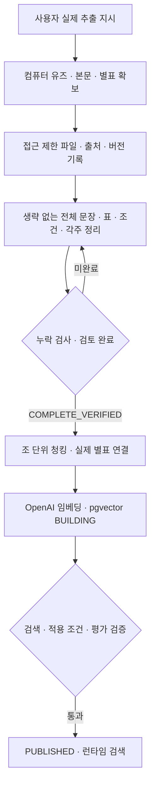

# AI·RAG 역할 설계 — PostgreSQL + pgvector · OpenAI API

상위 문서: [전체 안내](README.md) · 연계: [API](03-backend.md), [DB](04-database.md), [QA](06-qa-operations.md)

## 1. 역할과 고정 정책

AI·RAG는 지정 자료의 전체 문장 정리·검토, 조 단위 청킹, 임베딩, 적격 검색과 OpenAI 답변 검증을 담당한다. 사용자 질문·업무 데이터와 근거 원문·메타데이터·벡터는 단일 PostgreSQL + pgvector에 저장한다. 초기에는 별도 벡터 서비스·RAG 프레임워크·재순위 모델·캐시를 추가하지 않는다.

답변 전에 **구성한 내부 RAG를 먼저 검색**한다. 외부 웹 검색·임의 사이트·사용자 URL·MCP·브라우징으로 부족한 정보를 보충하지 않는다. 모델의 사전 지식도 보수 기준의 근거가 아니다. 자료가 부족하면 안내 불가와 관리사무소·담당 기관 직접 문의를 알리고 연락처를 넣지 않는다.

비로그인은 설문만 가능하고 생성형 챗봇은 로그인 사용자에게 제공한다. 설문도 내부 RAG를 검색하지만 생성 호출 대신 검토된 안내 템플릿을 사용한다. 안전·범위·입력 부족의 기본 정책은 근거의 세부 내용을 새로 추정하지 않는다.

## 2. 자료 범위와 실제 추출 조건

원문은 [지정 국가법령정보센터 링크](https://www.law.go.kr/admRulLsInfoP.do?chrClsCd=&admRulSeq=2100000282400#AJAX)다. 대상은 **제2장 제7~45조와 제6조의2**, 직접 연결된 **별표 2·3·4의 실제 내용 전체**다. 실제 연결은 제10조제2항→별표 2, 제42조제5항→별표 3, 제43조제2항→별표 4이며 제6조의2에는 별표 2 참조가 없다.

**실제 추출은 사용자가 지시할 때 컴퓨터 유즈로 수행한다.** 2026-10-04 사용자의 M08 지시에 따라 본문과 별표 PDF를 확인하고 원문 정리의 완전성을 검토했다. 화면 표시 버전은 국토교통부고시 제2026-360호(2026-07-08 시행)다. [M08 기록](../progress/02-m08-source-review.md)에 원문·정리본·coverage·manifest와 적용 검토 사항을 연결했다. 이 운영 준비 작업과 서비스 답변의 외부 검색 금지를 구분한다.

M08의 COMPLETE_VERIFIED는 지정 범위의 전사·완전성 검토 완료다. 사람의 법률 검토나 APPROVED·PUBLISHED를 뜻하지 않는다. 제35조제2항의 부칙 적용례, 별표 4 ‘파손 및 손상’ 문구의 의미, 외부 인용 규정 및 주택별 적용 조건은 후속 적격성 검토에 반영한다. 의미가 미확인인 별표 4 행은 공식 확인 전 자동 판정 규칙으로 사용하지 않는다. LH_OPERATION은 미확보 상태다. M09에서는 별도 검토로 법령 참고/설명 용도를 한정해 49개 청크를 게시했다. 미확인 별표 4/제43조와 외부 규정 내용에 의존하는 제35조·제45조 등은 적용 설명에서 제외한다. [검토·실제 평가 기록](../progress/04-m09-knowledge-review.md)을 따른다.

| 종류 | 용도 | 구분 |
| --- | --- | --- |
| LAW_CRITERIA | 하자판정 관련 조문·별표 설명 | LH 실제 보수·교체·비용 규칙으로 대체하지 않음 |
| LH_OPERATION | 적용 범위가 확인된 유지보수 운영 안내 | 공식 원문·주택 유형·조건·기간 검토 필요 |
| SAFETY_SOURCE | 검토된 위험 안내 | 원문을 근거로 승인 문구 작성; 연락처는 답변 제외 |

기존 증상 예시나 미검증 연한을 자료·검색 태그·정답 규칙으로 넣지 않는다. 사용자 질문이 많이 반복돼도 공식 근거가 되지는 않는다.

## 3. 정리 완료 전 RAG 투입 금지



자료를 확보했다는 이유만으로 바로 전부 청킹·임베딩하지 않는다. 순서는 원문 확보 → 전체 문장 정리 → 완전성 검토 → 조 단위 청킹 → 임베딩·릴리스 게시다.

### 원문 확보·전체 문장 정리

1. 지정 원문 URL·수집 시각·버전·시행일·내용 해시를 기록한다. 날짜를 확인할 수 없으면 null로 남긴다.
2. 제6조의2와 제7~45조를 본문·항·호·단서·예외까지 누락 없이 확보한다. 원문에 존재하지 않거나 변경된 항목도 원문 확인 결과를 기록한다.
3. “별표 2와 같다” 등의 링크·파일을 따라 실제 별표 2·3·4의 제목·행·열·단위·조건·각주를 읽는다. 참조 표현만 남기지 않고 그 전체 내용을 이해할 수 있도록 정리한다. 다른 법령의 별표 참조와 이 고시의 별표를 구분한다.
4. 원문과 정리본은 구분한다. 번호·수치·조건을 임의로 생략하거나 모델이 빈 부분을 보충하지 않는다. 의미를 풀어 쓴 문장에는 원문 위치를 연결한다.
5. coverage 표에 조문별 확보·정리·별표 연결·누락 여부·검토자·검토일을 기록한다.
6. 누락된 항목·접근 실패·미확인 별표가 있으면 COMPLETE_VERIFIED로 승격하지 않는다. 자동 추출 실패를 요약 생성으로 덮지 않는다.

원문·정리본·coverage는 처음에는 접근이 제한된 파일과 검토 manifest로 관리한다. manifest에는 COMPLETE_VERIFIED, 검토자·일시, 대상 범위, 파일 해시, 별표 연결을 기록한다. 별도의 수집·정리 상태 테이블·관리 화면은 두지 않는다. 반입 명령은 완료 상태와 파일 해시·누락 항목을 확인하며 검토 전에는 청크·임베딩을 생성하지 않는다.

검토 완료 자료만 knowledge_sets BUILDING과 knowledge_documents로 반입한다. 임베딩·검색 평가가 완료되면 한 트랜잭션으로 PUBLISHED 처리한다. 런타임은 PUBLISHED·APPROVED만 조회한다. 실패한 BUILDING 묶음은 수정 후 명시적으로 재실행할 수 있으며 이미 게시한 내용을 덮어쓰지 않는다. 관련 별표 ID·안내 템플릿은 청크 metadata_json에 두고 게시 전에 같은 묶음의 실제 근거로 연결됐는지 검사한다.

### 조 단위 청킹

한 조의 전체 본문을 기본 한 청크로 구성한다. 별표는 실제 내용·조건을 보존한 청크로 만들고 조문 청크 metadata_json의 relatedChunkIds로 연결한다. 초기에는 별도 관계 테이블을 두지 않는다. “별표 2와 같다”만 있는 청크를 독립적인 안내 근거로 사용하지 않는다.

조 제목·본문·예외·적용 조건은 함께 검색할 수 있게 유지한다. 한 조가 모델의 입력 한도를 넘으면 잘라서 버리지 않고 문맥 보존 분할을 별도로 검토한다. 원문 ID·버전·조문 위치·별표 관계·정리본·내용 해시를 추적한다.

## 4. 임베딩과 검색

OpenAI Embeddings API를 사용한다. 사용자가 확정한 설정은 text-embedding-3-large·1536차원·cosine이며 dimensions=1536을 명시한다. M09의 실제 53건 평가는 카탈로그 태그/명시적 조문으로 후보를 제한한 검색 계약을 검증하며 한국어 전반이나 small 대비 우월성을 검증한 결과는 아니다. 문서와 질문은 같은 모델·차원을 사용한다. knowledge_sets에 모델·차원을 기록하고 knowledge_chunks에 본문과 벡터를 함께 저장한다. 별도 프로필·임베딩 테이블은 두지 않는다. large의 기본 차원은 3072이며 서비스는 요청 차원을 1536으로 줄인다. 임베딩 총비용 상한은 사용자 요청에 따라 두지 않으며 요청별 입력·시간 한도와 자동 재시도 금지는 유지한다. [OpenAI Embeddings](https://developers.openai.com/api/docs/guides/embeddings)

모델·본문이 바뀌면 임베딩을 재생성하고 새 지식 묶음을 만든다. 초기에는 하나의 활성 모델·고정 차원 열만 운영하며 차원 변경 시 마이그레이션과 재임베딩을 수행한다. 서로 다른 모델의 같은 길이 벡터를 비교하지 않는다. 사용자 질문 벡터는 요청 메모리에만 두고 RAG 지식에 장기 저장하지 않는다.

검색 순서는 다음과 같다.

1. 현재 카탈로그·주택·시설물·증상·답 라벨로 질문을 구성하고 식별정보를 정제한다.
2. 같은 DB의 세션 고정 지식 묶음·APPROVED 자료·검토 기한·주택 적용 범위·모델·차원을 제한한다.
3. pgvector 정확 검색으로 최대 20개 후보를 얻고 완성 목록의 태그·동의어로 관련성을 보완한다.
4. 시행일·시설물·예외·실제 별표·자료 종류·운영 조건을 검증한다.
5. 중복을 제거한 조문·별표 근거 묶음 최대 5개를 구성한다. 적용 근거가 없으면 생성하지 않고 기본 안내로 전환한다.

pgvector와 PostgreSQL은 메타데이터 필터와 벡터 검색을 같은 저장소에서 연결할 수 있다. **초기에는 정확 검색**으로 시작한다. 검색 시간이 목표를 넘을 때 SQL·자료 범위를 먼저 점검하고 HNSW를 검토한다. 별도 재순위 모델·하이브리드 검색은 정확 검색의 품질 한계가 평가셋에서 확인될 때 추가한다. [pgvector](https://github.com/pgvector/pgvector)

## 5. 근거 적격 게이트

| 검사 | 통과 조건 | 실패 |
| --- | --- | --- |
| 전체 정리 | COMPLETE_VERIFIED, 대상 조문·별표·생략 항목 검토 | 청킹·임베딩·게시 금지 |
| 게시·검토 | 세션의 PUBLISHED 릴리스·APPROVED 원문·reviewUntil 미경과 | 검색·새 안내 제외 |
| 원문·벡터 | 청크와 임베딩 내용 해시·모델·차원 일치 | 해당 후보 제외 |
| 현행·범위 | 확인된 시행 기간·주택·시설물·상위 조건과 일치 | 관련 참고 또는 추가 확인 |
| 별표 | 실제 표·조건·예외·각주가 연결 | 적용 안내 금지 |
| 운영 결론 | 해당 운영 안내를 뒷받침하는 LH_OPERATION 등 적격 자료 | 법령만으로 운영 판정 금지 |
| 충돌 | 같은 맥락의 상충 자료 없음 | SOURCE_CONFLICT·직접 문의 |
| 생성 출력 | 주장·인용·수치·조건이 적격 근거에 연결되고 연락처 없음 | 문장 제거 또는 TEMPLATE |

Citation.use는 참고 RELATED, 적용 조건을 확인한 근거 APPLICABLE이다. 검색 점수는 정답 확률이 아니며 임의 점수 임계값 하나로 안내 가능성을 결정하지 않는다.

### 법령 설명과 운영 문의의 구분

적격성은 현재 질문의 목적에 대해 판단한다. 아래 분기는 공통 안전·지원 범위·필수 정보 확인을 통과한 뒤 적용하며 그 우선순위를 바꾸지 않는다.

| 요청 | 법령만 확보한 경우 | 상태·생성 |
| --- | --- | --- |
| 회원의 명시적인 조문·별표 설명 | 설명에 필요한 검토된 LAW_CRITERIA가 충분하면 설명 허용; LH 운영 판단 제외 | GUIDANCE_AVAILABLE·GROUNDED, 내부 검색 후 생성 가능 |
| 설문 또는 LH 보수·교체·비용 문의 | 운영 근거 부족; 법령은 RELATED 참고만 제공 | NEED_CONFIRMATION; 설문 승인 템플릿, 채팅 TEMPLATE·생성 생략·직접 문의 |
| 설명과 운영 판단이 섞이거나 목적이 불분명한 문의 | 운영 문의 기준 적용 | 운영 근거가 없으면 NEED_CONFIRMATION·생성 생략 |

법령 설명의 APPLICABLE은 해당 설명을 뒷받침한다는 뜻이며 LH 운영 적용을 뜻하지 않는다. 질문 목적은 현재 채팅 내용과 확인된 맥락으로 서버가 생성 전에 판별하고, 명확히 구분할 수 없으면 운영 문의로 처리한다. 모델이 목적·status를 바꿔 운영 근거 게이트를 우회하지 못하게 한다. 설명 자체의 근거도 없거나 충돌하면 기본 안내로 전환한다.

## 6. OpenAI 생성 계약

생성은 OpenAI Responses API를 사용하고 모델명은 OPENAI_CHAT_MODEL 설정으로 결정한다. 사용자가 지정한 모델은 gpt-5.4-mini다. M10에서 생성 연동·실제 12건 평가를 마쳤다. 현재 구현은 검토된 조문 전체/승인 문구를 선택해 제시하며 자유 재서술은 기본 안내로 전환한다. 연결 별표의 전체 셀·비고는 서버에서 조립한다. [M10 구현·제한](13-member-chat.md)을 따른다. SDK 자동 재시도는 끄고 전체 시간·비용을 서버가 통제한다.

호출 전 항상 내부 검색·적격 확인을 마친다. 근거가 없으면 모델 호출을 건너뛴다. 호출에는 목적/명시적 조문 번호·검토된 선택/답 라벨·최근 최대 6개 메시지의 같은 분류/조문 추출값·적격 근거만 전달한다. 자유 입력 전체는 전송하지 않는다. 이전 AI 답변은 근거가 아니다.

| 요청 설정 | 정책 |
| --- | --- |
| tools | 빈 배열; web_search·브라우징·MCP·외부 조회 없음 |
| instructions | 제공 근거로만 설명, 사전 지식의 보수 규칙 추가 금지, 부족하면 직접 문의 |
| store | false; 자체 PostgreSQL 이력과 별도 |
| text.format | JSON Schema Structured Outputs로 statements·evidenceChunkIds·followUpQuestions 제한 |
| 모델·출력 길이 | 평가한 모델·max_output_tokens·비용 상한을 설정 |

Responses와 Structured Outputs의 필드·저장 동작은 공식 문서로 확인한다. 구조화 출력은 사실의 정확성을 보장하지 않으므로 서버 검증을 유지한다. [Responses API](https://developers.openai.com/api/docs/guides/migrate-to-responses), [Structured Outputs](https://developers.openai.com/api/docs/guides/structured-outputs)

```text
GeneratedDraft
  statements: [{text, evidenceChunkIds}]
  followUpQuestions: string[]

ValidatedAnswer
  answerMode: GROUNDED | CLARIFY | TEMPLATE
  content: 일반 텍스트
  citations: DB 메타데이터로 조립한 Citation[]
  followUpQuestions: string[]
  validationReasons: 원문 없는 내부 코드
```

공통 결정 서비스의 status는 모델이 변경할 수 없다. 필요한 확인은 followUpQuestions로 표현하고 사용자가 기존 목록에서 다시 선택한다. 별도 선택 자동 변경·추론 에이전트는 두지 않는다. 모델이 만든 URL·날짜·자료 제목은 사용하지 않고 서버가 PostgreSQL 메타데이터로 조립한다. 인용 ID 존재만 검사하지 않고 주장·수치·보수 조건·확정 표현까지 원문·승인 템플릿과 대조한다.

연락처·전화번호·이메일·전화 링크는 content·checks·문의 문구·안전 안내·모델 출력에서 차단한다. 출처 원문 HTTPS 링크는 근거 확인용으로 유지한다. 자동 검증으로 해결되지 않는 내용은 승인된 문구로 제한하고 표본 사람 검토를 수행한다.

## 7. 모르는 내용·장애·전송

기본 응답은 “관련 정보가 부족하여 안내해 드리기 어려워요. 관리사무소 또는 담당 기관에 직접 문의해 주세요.”다. 담당 기관 확인 문구를 함께 제공하고 연락처는 붙이지 않는다. 부족한 조건이 사용자가 제공할 수 있는 정보라면 확인 질문만 추가한다.

임베딩 실패·검색 부재·근거 충돌·모델 timeout·429·5xx·refusal·잘못된 스키마·가짜 인용이면 사전 지식이나 외부 검색으로 우회하지 않는다. DB가 정상이라면 TEMPLATE 또는 CLARIFY로 저장·반환한다. 단일 PostgreSQL 장애·완료 저장 실패는 503이며 안내나 이력이 저장된 것처럼 표시하지 않는다.

채팅 전체는 25초, OpenAI 생성 호출은 남은 예산 내 최대 20초, 질문 임베딩은 최대 5초를 초깃값으로 한다. 생성과 임베딩에 각각 한도를 모두 쓴 뒤 전체 제한을 초과하지 않도록 남은 deadline을 전달한다. 문서 임베딩은 사용자 요청과 분리하며 API 이미지의 일회성 관리 명령으로 실행한다. 상시 워커·자동 큐 재처리는 없다.

OpenAI에는 최소한의 정제 입력만 보낸다. store=false가 제공자의 모든 보존을 0으로 만든다는 의미는 아니며 프로젝트의 3~5년 자체 질문 보존과 OpenAI의 데이터 제어는 구분한다. 제공자 보존 설정·전송 고지를 운영 설정과 함께 확인한다. [OpenAI 데이터 제어](https://developers.openai.com/api/docs/guides/your-data)

## 8. 평가·인수 기준

평가셋은 실제 목록이 완성된 뒤 대표 항목을 바탕으로 별도 합성 질문을 작성한다. 기존 증상 예시를 운영 후보로 재활용하지 않는다. 정답 상태·적격 청크·별표·금지 주장·누락 조건을 자료 검토자가 승인한다.

- 전체 문장 정리 미완료 상태에서 청킹·임베딩·게시가 차단된다.
- 제6조의2·제7~45조·실제 별표 2·3·4의 coverage와 원문 위치를 추적한다. 총칙·부칙의 적용 조건도 함께 보존한다.
- 검색 호출이 생성보다 먼저 이루어지고, 무근거 요청에서는 생성 호출이 없다.
- 외부 검색 도구·임의 URL 접근·모델 사전 지식 보충이 없다.
- 답변·안전·문의 문구에 연락처가 없다.
- 준비한 출시 평가셋에서 없는 출처·비용/교체 확정·철회 자료·위험 우선순위 위반은 0건을 목표로 검증한다.
- 적격 정답이 있는 사례의 recall@5 ≥ 90%, 상태 정확도 ≥ 95%를 초기 목표로 측정한다. 목표이며 달성 보고가 아니다.
- 같은 법령 자료에 대해 조문 설명 질문은 근거 기반 설명, 운영 판단 질문은 운영 근거 부족 안내가 되는지 따로 평가한다. 혼합·불명확한 질문도 운영 판단을 우회하지 않는지 확인한다.
- 자료·임베딩·프롬프트·생성 모델을 바꿀 때 같은 평가셋으로 재검증한다.
