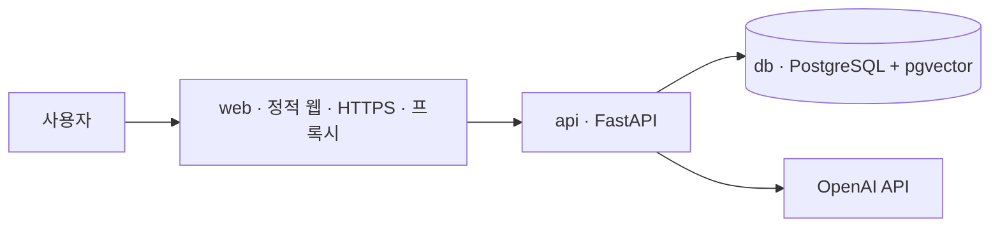

# 우리집 보수 길잡이 — 전체 개발 안내

최초 작성: 2026-10-02 · 최종 개정: 2026-10-05 · 상태: M01~M10 완료 · 다음 M11

이 문서는 서비스의 기본 범위·기술 구성·공통 정책과 문서의 읽는 순서를 안내한다. [기존 초안](../README.md)은 서비스 방향을 참고하는 자료이며 최신 요구와 구현 기준은 이 문서와 연결된 설계를 따른다.

## 1. 서비스 개요

우리집 보수 길잡이는 주택·시설물·증상과 간단 설문을 바탕으로 검토된 자료에서 관련 보수 기준과 확인할 내용을 안내하는 서비스다. 로그인 사용자는 챗봇과 이전 결과 조회도 이용할 수 있다.

기본 이용 흐름은 주택·증상 선택 → 간단 설문 → 결과·근거 확인 → 필요한 경우 담당 기관 직접 문의다. 결과에는 항상 “실제 보수 여부는 담당 기관 확인이 필요해요.”를 표시한다.

## 2. 범위와 이용 권한

지원 대상은 LH 건설임대주택과 분양전환형 주택의 임대 거주 기간이다. 실제 보수 접수·승인·비용 부담 확정·현장 진단·사진·관리자 웹 화면은 초기 범위 밖이다.

| 기능 | 비로그인 | 로그인 |
| --- | --- | --- |
| 간단 설문·현재 결과 | 가능 | 가능 |
| 결과 서버 저장 | 익명 상담에 저장 | 계정 소유 결과로 저장 |
| 챗봇 | 불가 | 가능 |
| 이전 결과 목록·상세 | 불가 | 본인 결과만 |
| 기록 삭제 | 유효한 현재 상담 토큰으로 삭제 | 본인 결과·질문 기록 삭제 |

화면은 홈·주택/증상 선택·설문·챗봇·현재 결과와 로그인/가입·회원 이력으로 구성한다. 기존 증상 예시는 사용하지 않는다. 2026-10-04 M08 실제 원문으로 작성·검토한 목록을 로컬 개발 DB에 게시했다. [M08A 기록](../progress/03-m08a-catalog-review.md)을 따른다. 새 환경에 목록이 없으면 준비 중으로 표시한다. M09에서 실제 지식 49개 청크를 임베딩·평가·게시하고 설문 검색을 연결했다. M10 회원 챗봇은 검토 원문 선택·인용 방식의 생성과 대화 저장·복구를 제공한다. [M10 검증](../progress/05-m10-chat-review.md)을 따른다.

회원 이력은 로그인 상태에서 생성한 결과부터 제공한다. 비회원 상담 중 로그인하면 새 회원 상담을 시작하며 과거 익명 결과를 계정에 연결하지 않는다.

## 3. 기술 구성과 배포

| 영역 | 기본 구성 |
| --- | --- |
| 프론트 | TypeScript + React + Vite, React Router, TanStack Query, React Hook Form |
| 백엔드 | FastAPI + Pydantic, SQLAlchemy 2 + Psycopg 3 + Alembic |
| 데이터 | 단일 PostgreSQL + pgvector에 업무 데이터·정제 질문·RAG 지식 저장 |
| AI | OpenAI Responses·Embeddings API, 서버에서만 호출 |
| 배포 | 한 서버의 Docker Compose: web·api·db 3개 상시 서비스 |
| 관리 작업 | API 이미지의 일회성 자료 반입·임베딩·게시·정리 명령 |

web은 React 빌드 파일·Caddy HTTPS·API 프록시를 제공한다. API는 초기 1개 워커로 실행하며 API·DB 포트는 외부에 직접 공개하지 않는다. DB와 인증서 데이터는 영속 볼륨에 보관하고 실제 비밀 값은 서버에서만 주입한다.

기술 선택 사유와 단순화 판단은 [설계 결정 기록](07-architecture-decisions.md), 배포 절차는 [QA·운영 설계](06-qa-operations.md)를 참고한다.

## 4. RAG와 자료 정책

- 답변 생성 전에 내부 RAG를 먼저 검색한다. 적격 정보가 없으면 모델 생성 없이 안내 불가·직접 문의를 제공한다.
- 외부 웹 검색·임의 URL 수집·MCP·모델 사전 지식으로 보수 기준을 보충하지 않는다.
- 답변·안전 안내·문의 문구에 연락처·전화번호·이메일을 넣지 않는다.
- 자료 범위는 제2장 제7~45조와 제6조의2, 직접 연결 별표 2·3·4의 전체 내용이다. 생략 항목·문장·조건·각주를 포함한다. 2026-10-04 [M08 완전성 검토](../progress/02-m08-source-review.md)를 마쳤으며 법률·운영 적용 승인은 별도다.
- 실제 원문 추출은 사용자가 지시할 때 컴퓨터 유즈로 수행한다.
- 전체 정리·검토 완료 뒤 조 단위 청킹·임베딩·게시한다. 검토 전 자료는 검색에 넣지 않는다.
- 법령 참고와 LH 실제 운영 기준을 구분하고 기간·비용·교체 여부를 확정하지 않는다.
- 명시적인 법령 설명 질문은 적격 법령만으로 설명할 수 있다. 운영 근거가 없는 설문·LH 보수·교체·비용 문의는 NEED_CONFIRMATION·직접 문의로 처리한다. 세부 상태·생성 기준은 AI·RAG 설계를 따른다.

## 5. 공통 규칙과 데이터 보존

JSON은 camelCase, DB 열은 snake_case, 시간은 UTC이고 화면은 Asia/Seoul로 표시한다. 상담·결과·요청은 UUID, 목록·지식 묶음은 버전 ID로 식별한다. 맥락 revision과 requestId로 충돌·중복 저장을 검출한다.

결과 상태는 SAFETY_PRIORITY, OUT_OF_SCOPE, NEED_MORE_INFO, NEED_CONFIRMATION, GUIDANCE_AVAILABLE이다. 자료·입력 부족은 정상 안내 상태이며 DB 저장 실패는 성공 응답으로 표시하지 않는다.

| 데이터 | 기본 보존 |
| --- | --- |
| 상담·계정 인증 세션 | 24시간 |
| 익명 원본 결과·대화·요청 응답 | 상담 만료 후 7일 이내 정리 |
| 회원 결과·정제 질문 | 3~5년 범위, 기본 5년; 3년 시점 활용 여부 검토 |
| 운영 로그·일일 백업 | 14일 |
| 삭제 기록 | 15일 |

회원 이력·장기 질문은 단기 상담 삭제와 분리한다. 명시적 삭제가 보존보다 우선하며 사용자 질문을 RAG 지식이나 모델 학습 데이터로 자동 편입하지 않는다. 세부 삭제·백업·복구 절차는 DB·운영 설계를 따른다.

결과 삭제 후 같은 요청을 재전송해도 복원·재실행하지 않는다. 본문 없는 DELETED 요청 기록을 상담 정리까지 유지한다. 회원 대화 조회는 질문·답변 쌍과 답변 방식·확인 질문을 함께 복원한다. 이번 계획 개정의 코드 반영은 [후속 항목](09-development-standards.md#5-계획-정합성-개정과-후속-반영)에 명시하며 M01~M03 완료 기록과 구분한다.

## 6. 문서 안내

먼저 전체 안내에서 공통 범위를 확인한 뒤 담당 역할의 설계를 읽는다. 정책은 기획·UX, HTTP 계약은 백엔드, 데이터 구조는 DB, 근거 검증은 AI·RAG, 출시 검증은 QA·운영 문서가 기준이다. 실제 팀에서는 역할을 겸할 수 있다.

| 역할 | 설계 | 책임 |
| --- | --- | --- |
| 기획·UX | [01-product-ux.md](01-product-ux.md) | 권한·완성 목록·화면·문구 |
| 프론트 | [02-frontend.md](02-frontend.md) | TypeScript 설문·로그인·챗봇·이력 |
| 백엔드 | [03-backend.md](03-backend.md) | FastAPI 인증·상담·저장·RAG |
| DB | [04-database.md](04-database.md) | 단일 PostgreSQL·pgvector·보존 |
| AI·RAG | [05-ai-rag.md](05-ai-rag.md) | 전체 정리·조 청킹·검색·OpenAI 검증 |
| QA·운영 | [06-qa-operations.md](06-qa-operations.md) | Docker Compose·권한·장애·복구 |

설계 판단과 후속 계획은 다음 문서에서 확인한다.

- [설계 결정과 단순화 기록](07-architecture-decisions.md): DB·프레임워크·운영 구성의 선택 사유와 초기 제외 항목
- [확장 기준과 구현 순서](08-scaling-roadmap.md): 측정할 문제·확장 조건·단계별 구현 순서
- [MVP 개발 진행 안내](../progress/README.md): 순서별 개발 작업·선행 조건·완료 기준·진행 상태
개발 계약·입력 형식·설정·버전 고정은 [개발 기준](09-development-standards.md)을 참고한다.

개발 기준: [입력 형식·설정·검증](09-development-standards.md) · 실행: [로컬 개발 안내](10-local-development.md)

카탈로그: [작성·검증·게시와 설문 정책](11-catalog-publication.md) · 지식: [반입·임베딩·검색·게시](12-knowledge-publication.md) · [M09 완료 기록](../progress/04-m09-knowledge-review.md)

회원 챗봇: [구현·한도·검증](13-member-chat.md)
