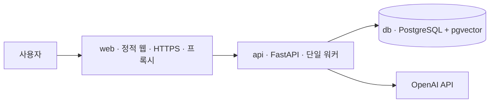

# 시스템 구성과 선택 기준

기준: [설계 안내](../README.md) · 연계: [DB](../data/database.md), [검증](../quality/verification.md), [확장 기준](scaling.md)

## 1. 구성과 책임

PostgreSQL + pgvector 한 DB에 업무 데이터와 RAG 지식을 저장한다. FastAPI 한 앱이 인증·권한·설문·회원 챗봇·결과 이력·지식 검색을 처리한다. React + TypeScript + Vite 정적 웹은 Caddy를 통해 API를 호출한다.

| 책임 | 선택 | 이유·경계 |
| --- | --- | --- |
| 관계 데이터·벡터 | PostgreSQL + pgvector | FK·완료 트랜잭션·복구 경로 통합; 단일 풀·migration 이력 |
| 요청 실행 | FastAPI 한 앱·한 워커 | 상담별 메모리 잠금; 외부 호출 중 DB 트랜잭션을 유지하지 않음 |
| 중복·실패·삭제 | requestId·완료 응답·FAILED·본문 없는 DELETED | 자동 작업 재시도 제외; 삭제 요청 재실행 차단 |
| 통계 | 정제 질문 SQL GROUP BY | 집계 중복·삭제 보정 방지 |
| 자료 검토 | 정리 파일·검토표 + 지식 묶음·문서·청크 | 검토 게이트·게시 불변성 유지 |
| 벡터 저장·검색 | 청크 행의 임베딩·cosine 정확 검색·적용 조건 | 한 모델·차원 운영; 측정 전 HNSW·재순위 계층 추가 없음 |
| 폼·서버 상태 | React Hook Form·TanStack Query | 간단한 UI 검사와 서버 Pydantic 검증; 별도 전역 상태·Zod 제외 |
| 회원 이력 | 회원 상태에서 생성한 결과 | 익명 결과의 계정 이전 제외 |
| 챗봇 | 별도 CHAT 세션·맥락 | 설문 없이 이용·대화만 초기화; 공통 DB·API·검토 지식 재사용 |

권한·CSRF·결과 저장·중복 방지·근거 검증·삭제·백업을 유지한다. 기능 경계·안정적인 ID·새 migration으로 변경을 관리한다. [챗봇 정책](../product/chat.md)에 따라 기존 세션 종료와 새 CHAT 생성을 사용하며 별도 초기화 API는 두지 않는다.

## 2. 프레임워크 선택

현재 화면은 정적 웹과 API로 제공하므로 Vite 빌드를 사용한다. SSR 웹 서버는 두지 않는다. FastAPI는 API와 Python RAG 처리를 같은 앱에서 제공한다. [Vite 정적 배포](https://vite.dev/guide/static-deploy.html), [FastAPI Docker 배포](https://fastapi.tiangolo.com/deployment/docker/), [pgvector](https://github.com/pgvector/pgvector)를 참고한다.

## 3. 배포와 한계

한 서버의 Docker Compose에서 web·api·db 3개 서비스를 상시 운영한다. web만 80/443을 공개하고 API·DB 포트는 내부로 제한한다. DB·인증서는 영속 볼륨에 저장한다. 자료 반입·임베딩·게시·정리는 API 이미지의 일회성 명령이며, PostgreSQL 도구가 필요한 백업·복원은 별도 ops 이미지를 사용한다. 상시 큐·워커·캐시 서비스는 두지 않는다.

단일 서버·단일 DB는 무중단·고가용성을 보장하지 않는다. DB 장애 시 결과 저장·이력 조회도 중단된다. 다중 API 워커 도입 전에는 메모리 상담 잠금·사용량 제한을 공유 실행 제어로 바꿔야 한다. [배포](../operations/deployment.md)·[백업/복원](../operations/retention-backup.md)·[확장 기준](scaling.md)을 따른다.
